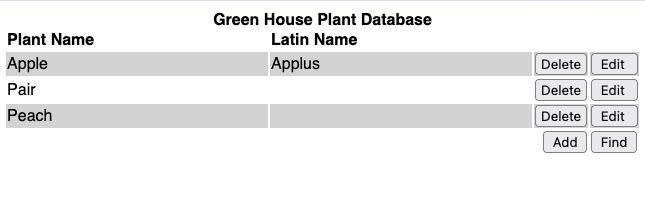
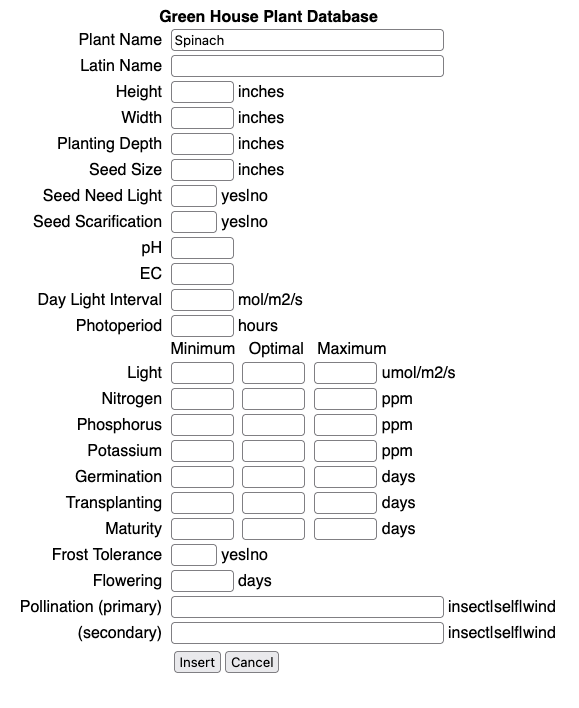

# ghdb-cgi-bin #
**Green House Database as a cgi-bin application**

This is an experiment to write the Green House Database application (https://github.com/donaldbales/ghdb originally a curses application) as a C Programming Language and cgi-bin web-based application. Admittedly ugly by modern web application practices, this is how we built them in the beginning (1993). It consist of only two HTML templates, one for a list view and a second for a form view. It uses no cascading style sheets (CSS) or Javascript. It is fully functional.

## Interface ##
### List View ###

### Form View ###


There are two HTML files. 

From these you can:
* Add a record
* Find one or more SQL expression matching records
* Edit a record
* Delete a record
* Import TSV records
* Export TSV records


## Database ##

```
mysql> desc ghdb;
+-----------------------+--------------+------+-----+---------+-------+
| Field                 | Type         | Null | Key | Default | Extra |
+-----------------------+--------------+------+-----+---------+-------+
| plant_name            | varchar(30)  | NO   | PRI | NULL    |       |
| latin_name            | varchar(30)  | YES  |     | NULL    |       |
| height                | decimal(5,2) | YES  |     | NULL    |       |
| width                 | decimal(5,2) | YES  |     | NULL    |       |
| planting_depth        | decimal(5,2) | YES  |     | NULL    |       |
| seed_size             | decimal(5,2) | YES  |     | NULL    |       |
| seed_need_light       | varchar(3)   | YES  |     | NULL    |       |
| seed_scarification    | varchar(3)   | YES  |     | NULL    |       |
| ph                    | decimal(5,2) | YES  |     | NULL    |       |
| ec                    | decimal(5,2) | YES  |     | NULL    |       |
| day_light_interval    | decimal(5,0) | YES  |     | NULL    |       |
| photoperiod_hours     | decimal(5,0) | YES  |     | NULL    |       |
| light_lower           | decimal(5,0) | YES  |     | NULL    |       |
| light_optimal         | decimal(5,0) | YES  |     | NULL    |       |
| light_upper           | decimal(5,0) | YES  |     | NULL    |       |
| nitrogen_lower        | decimal(5,0) | YES  |     | NULL    |       |
| nitrogen_optimal      | decimal(5,0) | YES  |     | NULL    |       |
| nitrogen_upper        | decimal(5,0) | YES  |     | NULL    |       |
| phosphorus_lower      | decimal(5,0) | YES  |     | NULL    |       |
| phosphorus_optimal    | decimal(5,0) | YES  |     | NULL    |       |
| phosphorus_upper      | decimal(5,0) | YES  |     | NULL    |       |
| potassium_lower       | decimal(5,0) | YES  |     | NULL    |       |
| potassium_optimal     | decimal(5,0) | YES  |     | NULL    |       |
| potassium_upper       | decimal(5,0) | YES  |     | NULL    |       |
| germination_lower     | decimal(5,0) | YES  |     | NULL    |       |
| germination_normal    | decimal(5,0) | YES  |     | NULL    |       |
| germination_upper     | decimal(5,0) | YES  |     | NULL    |       |
| transplanting_lower   | decimal(5,0) | YES  |     | NULL    |       |
| transplanting_optimal | decimal(5,0) | YES  |     | NULL    |       |
| transplanting_upper   | decimal(5,0) | YES  |     | NULL    |       |
| maturity_lower        | decimal(5,0) | YES  |     | NULL    |       |
| maturity_optimal      | decimal(5,0) | YES  |     | NULL    |       |
| maturity_upper        | decimal(5,0) | YES  |     | NULL    |       |
| frost_tolerance       | varchar(3)   | YES  |     | NULL    |       |
| flowering             | decimal(5,0) | YES  |     | NULL    |       |
| pollination_primary   | varchar(30)  | YES  |     | NULL    |       |
| pollination_secondary | varchar(30)  | YES  |     | NULL    |       |
+-----------------------+--------------+------+-----+---------+-------+
37 rows in set (0.00 sec)

```
The underlying database is hosted on MySQL. Prepared INSERT, SELECT, UPDATE, and DELETE SQL statements are used to prevent SQL injection. Since the use of cgi-bin prevents the caching of SQL connections and prepared statements between transactions, the use of prepared statements is slightly slower than using simple SQL statements.


## Apache Config ##
```
sudo nano /etc/apache2/conf-enabled/serve-cgi-bin.conf

<IfModule mod_alias.c>
        <IfModule mod_cgi.c>
                Define ENABLE_USR_LIB_CGI_BIN
        </IfModule>

        <IfModule mod_cgid.c>
                Define ENABLE_USR_LIB_CGI_BIN
        </IfModule>

        <IfDefine ENABLE_USR_LIB_CGI_BIN>
                ScriptAlias /cgi-bin/ /usr/lib/cgi-bin/
                <Directory "/usr/lib/cgi-bin">
                        AllowOverride None
                        Options +ExecCGI -MultiViews +SymLinksIfOwnerMatch
                        Require all granted
                        SetEnv MYSQL_DB "don"
                        SetEnv MYSQL_HOST "192.168.0.222"
                        SetEnv MYSQL_PWD "password"
                        SetEnv MYSQL_USER "don"
                </Directory>
        </IfDefine>
</IfModule>

sudo systemctl restart apache2
```

## cgi-bin Support in the C Programming Language. ##

I looked, but did not find a library of cgi-bin supporting functions for the C Programming Language, so I wrote them. Here's my minimal set:

```
/* these function can all be found in file ghdb-cgi-bin.c */

/*
 Reads a file into a string buffer. Used to read the HTML
 form and list files, so placeholders can be replaced with 
 values using strrep().
*/
char * get_asset(char *file_name)

/*
 Reads the POSTed application/x-www-form-urlencoded message 
 data from stdin parsing the key-value pairs into an array 
 of struct KEY_VALUE.
*/
struct KEY_VALUE * get_post_data(int *key_values_length)

/* 
 HTML encodes values so they can be used in HTML markup.
 It replaces: <, >, &, " and ' with &lt;, &gt;, &amp;,
 &quot; and &apos; respectively.
*/
char * html_encode(char *string) 

/*
 A search and replace function for character strings.
*/
char * strrep(char *string, const char *search, const char *replace)

/*
 URL decodes percent-encoded data from a POSTed HTML form,
 an application/x-www-form-urlencoded message. 
*/
char * url_decode(char *string)
```

## Developer Techniques ##

When a cgi-bin program is executed, 
* stdout is sent to the end-users browser, 
* stderr to the Apache error log (/var/log/apache2/error.log) and 
* stdin will contain the POSTed application/x-www-form-urlencoded message, which is a set of key-value pairs separated by the & character. For example:

```
plant_name=Apple&latin_name=Dumpling&height=&width=&planting_depth=&seed_size=&seed_need_light=&seed_scarification=&ph=&ec=&day_light_interval=&photoperiod_hours=&light_lower=0&light_optimal=&light_upper=&nitrogen_lower=&nitrogen_optimal=&nitrogen_upper=&phosphorus_lower=&phosphorus_optimal=&phosphorus_upper=&potassium_lower=&potassium_optimal=&potassium_upper=&germination_lower=&germination_normal=&germination_upper=&transplanting_lower=&transplanting_optimal=&transplanting_upper=&maturity_lower=&maturity_optimal=&maturity_upper=&frost_tolerance=&flowering=&pollination_primary=&pollination_secondary=&submit=Update
```

Accordingly, you can simulate this behaviour while developing a program using a command like the following:

```
cat Apple.txt | env CONTENT_LENGTH=`stat -c %s Apple.txt` ./select.cgi
```

Above, I put the key-value pairs in a file named Apple.txt. The command pipes the contents of that file into stdin, next the command sets the content length by stating the file for its length and then executes the select.cgi program.

The entire output of the program, both stdout and stderr show up on your screen. This is a much easier development loop than deploying and executing the binary via a cgi-bin URL.

Similarly, you can simulate a GET response by setting the QUERY_STRING environment variable with the key-value pairs as follows:

```
env QUERY_STRING="plant_name=Apple&latin_name=Dumpling" ./select.cgi
```

To see the error messages output once deployed to the cgi-bin directory, you can tail the log file as follows:

```
tail -f /var/log/apache2/error.log
```

##  Memory Management ##
I've only coded a minimum amount of memory management, because it's a cgi-bin program that will release all of the dynamically allocated memory as soon as the program completes.


## Links ##

### cgi-bin ###

RFC 3875: The Common Gateway Interface (CGI) Version
https://www.rfc-editor.org/info/rfc3875/#section-4.1

### GHDB ###
https://github.com/donaldbales/ghdb

## Feedback ##
You're welcome to contact me via email at don@donaldbales.com
  


